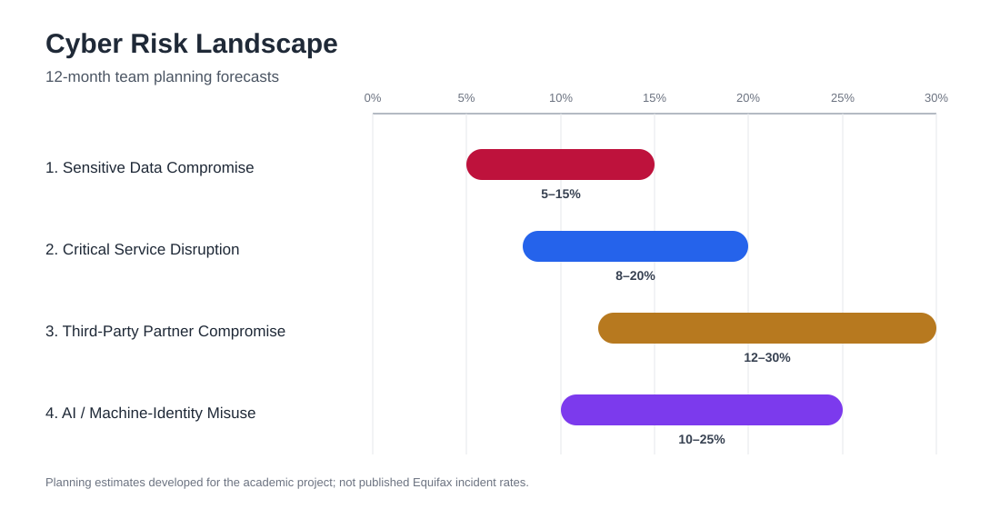

# Equifax Cybersecurity Risk & Resilience Assessment

A team-based cybersecurity strategy project evaluating Equifax's cyber risk landscape and developing a phased 36-month resilience roadmap.

The assessment connects cybersecurity risk to business operations, consumer trust, service availability, governance, and executive decision-making. It focuses on four major risk areas: sensitive data compromise, critical service disruption, third-party partner compromise, and AI / machine-identity misuse.

## Project Highlights

- Developed 12-month planning forecasts for four major cyber risk scenarios using an outside-in + Equifax-specific assessment approach.
- Evaluated probability, business impact, assumptions, control maturity, and potential exposure for each risk.
- Built strategic priorities around Zero Trust, Privileged Access Management (PAM), operational resilience, third-party risk management, and AI / machine-identity governance.
- Defined measurable outcomes for privileged access, recovery testing, third-party oversight, and high-risk automated workflows.
- Created a 36-month roadmap covering immediate baselining, mid-term control expansion, and long-term validation and continuous improvement.
- Connected cyber strategy to governance, compliance, executive accountability, and business continuity.

## Cyber Risk Landscape

| Risk Scenario | 12-Month Planning Range |
| --- | ---: |
| Sensitive data compromise / manipulation | 5–15% |
| Critical decision-service disruption | 8–20% |
| Trusted third-party / partner compromise | 12–30% |
| AI-agent / machine-identity misuse | 10–25% |

These ranges are team-developed planning estimates for the project, not published Equifax incident rates. They were designed to support prioritization under uncertainty and should be updated as evidence and assumptions change.

## Strategic Priorities

1. **Zero Trust & Identity Governance** — Reduce implicit trust through continuous verification, least privilege, time-limited privileged access, PAM, and microsegmentation.
2. **Operational Resilience** — Strengthen backups, failover testing, dependency mapping, and recovery exercises for critical decision services.
3. **Third-Party Risk Management** — Rank critical partners, tighten access and contract controls, and establish joint incident-response ownership.
4. **AI & Machine-Identity Governance** — Inventory automated workflows and machine identities, assign business owners, enforce least privilege, and monitor behavioral drift.

## My Contribution

This was a team project. My primary presentation responsibility was the **Cyber Risk Landscape** section, including the four 12-month forecast ranges and the reasoning behind them. I contributed to explaining how outside-in evidence, Equifax-specific exposure and controls, business impact, and uncertainty shaped the final risk forecasts.

## Project Deliverables

- [Cybersecurity Strategy Report — GitHub version](docs/Cybersecurity_Strategy_Report.md)
- [Executive Strategy Presentation — GitHub version](docs/Executive_Strategy_Presentation.md)

The original final report and presentation were submitted as PDF deliverables. The versions above are formatted specifically for GitHub so the analysis is easy to review directly in the repository.

## Skills Demonstrated

Cyber Risk Assessment • Risk Forecasting • Zero Trust • PAM • Third-Party Risk • Operational Resilience • AI Governance • NIST CSF • Cybersecurity Strategy • Governance & Compliance • Executive Communication

## Project Context

Academic team project completed for **MIT 5970: Cyber Strategy & Compliance** at the University of Oklahoma.

The assessment is based on publicly available information and course frameworks. Potential control gaps discussed in the project are assessment hypotheses and design risks, not verified findings from an internal Equifax audit.
